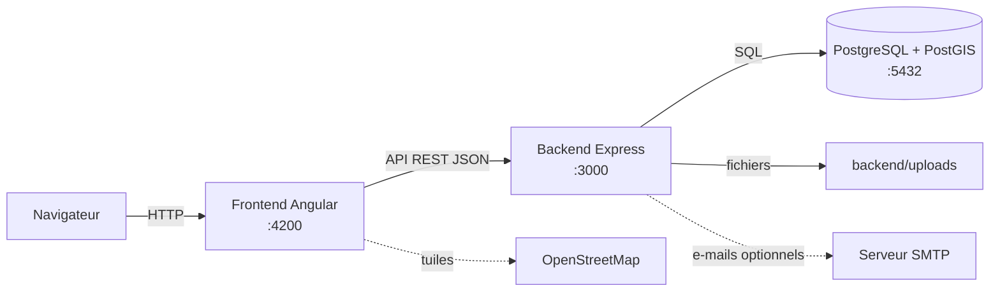

# MADINTY

> **Your City. Your Voice. Our Future.**

Plateforme web collaborative de signalement et de suivi des problèmes urbains (voirie, éclairage, propreté, eau…).
Un citoyen signale un problème sur la carte, l'organisme responsable le traite, une équipe intervient, et le citoyen confirme ou conteste la résolution.

Projet Web – Sup'Com, Groupe 4 (Haj Said Ahmed, Laouini Rawand), encadré par Dr. Maroua Nouioua.

---

## Sommaire

1. [Fonctionnalités](#fonctionnalités)
2. [Choix techniques](#choix-techniques)
3. [Architecture](#architecture)
4. [Structure du projet](#structure-du-projet)
5. [Lancer le projet sur votre PC](#lancer-le-projet-sur-votre-pc)
6. [Comptes de démonstration](#comptes-de-démonstration)
7. [Tests](#tests)
8. [Commandes utiles](#commandes-utiles)
9. [Dépannage](#dépannage)

---

## Fonctionnalités

| Espace | Fonctionnalités développées |
|---|---|
| **Public** | Accueil avec carte interactive (filtres, heatmap), fiche d'un signalement, organismes partenaires, « Comment ça marche », contact |
| **Authentification** | Inscription citoyen, connexion, mot de passe oublié / réinitialisation (lien à usage unique), rôles |
| **Citoyen** | Nouveau signalement (photos, géolocalisation, détection de doublons), soutien d'un signalement, suivi (« Mes signalements »), confirmation ou contestation de la résolution, notifications |
| **Organisme** | Tableau de bord, signalements reçus, acceptation / rejet motivé, priorité, affectation d’interventions, équipes, contestations, indicateurs |
| **Terrain** | Missions affectées, démarrage, avancement, compte rendu, photos avant / après, soumission à validation |
| **Administration** | Utilisateurs et rôles, catégories, paramètres (délai de contestation), journaux d'audit |

> **Avancement du frontend :** les espaces **Public**, **Citoyen**, **Organisme** et **Terrain** sont disponibles. L’espace **Administration** reste à développer ; ses fonctionnalités principales existent côté API REST.

## Choix techniques

| Couche | Technologie | Pourquoi |
|---|---|---|
| Frontend | Angular + TypeScript, Leaflet / OpenStreetMap | Structure imposée adaptée à plusieurs espaces par rôle, routes protégées, carte gratuite sans clé d'API |
| Backend | Node.js + Express (API REST) | Un seul langage du navigateur au serveur, léger, simple à maintenir |
| Base de données | PostgreSQL + PostGIS | Données très relationnelles, PostGIS pour la détection de doublons par proximité |
| Environnement | Docker Compose | Même environnement pour toute l'équipe, une seule commande pour tout lancer |

Sécurité : mots de passe hachés (bcrypt), JWT, contrôle d'accès par rôle, validation côté serveur, limitation de débit, `helmet`, vérification du type réel des fichiers envoyés.

## Architecture



Trois conteneurs Docker, orchestrés par `docker-compose.yml` :

| Service | Port | Rôle |
|---|---|---|
| `frontend` | 4200 | Interface Angular (rechargement automatique) |
| `backend` | 3000 | API REST : authentification, règles métier, workflow des signalements |
| `db` | 5432 | PostgreSQL + PostGIS, initialisé automatiquement au premier démarrage |

## Structure du projet

```
madinty/
├── docker-compose.yml          Orchestration des 3 services
├── .env.example                Modèle des variables d'environnement
├── README.md
│
├── frontend/                   Application Angular
│   ├── Dockerfile · nginx.conf
│   └── src/
│       ├── index.html · main.ts · styles.scss
│       ├── assets/             Favicon et ressources statiques
│       └── app/
│           ├── app.routes.ts · app.config.ts · app.component.ts
│           ├── core/           Socle technique (sans interface)
│           │   ├── config/        URL de l'API
│           │   ├── guards/        Protection des routes par rôle
│           │   ├── interceptors/  Jeton JWT sur les requêtes
│           │   ├── models/        Types et modèles (auth, signalements)
│           │   ├── services/      Appels API (auth, signalements, public)
│           │   └── utils/         Validateurs, mots de passe, erreurs
│           ├── shared/         Composants réutilisables
│           │   ├── icon · map · site-header · site-footer
│           │   ├── password-field · password-strength · support-button
│           │   └── styles/        Styles partagés
│           └── features/       Une page ou un espace = un dossier
│               ├── home/ · organismes/ · info/ · signalement/
│               ├── citoyen/       Nouveau signalement, mes signalements
│               └── auth/          Fenêtre de connexion / inscription
│
├── backend/                    API Node.js / Express
│   ├── Dockerfile
│   ├── tests/                  Tests automatisés (Node.js)
│   │   ├── api/                API testée en mémoire 
│   │   ├── smoke.js            Scénario réel de bout en bout  
│   │   └── smoke_workflow.js   Parcours complet d'un signalement           
│   ├── uploads/                Photos envoyées (non versionnées)
│   └── src/
│       ├── index.js            Point d'entrée
│       ├── app.js              Configuration Express et montage des routes
│       ├── config/db.js        Pool PostgreSQL et transactions
│       ├── middleware/         Authentification, rôles, validation
│       ├── routes/             Un fichier par espace (auth, citizen, organisme, equipe, admin, public…)
│       └── lib/                Logique métier (workflow, priorité, notifications, upload, tâches planifiées)
│
└── db/init/                    Scripts SQL exécutés dans l'ordre au premier démarrage
    ├── 01-extensions.sql       Activation de PostGIS
    ├── 02-schema.sql           Schéma relationnel (16 tables)
    └── 03-seed-data.sql        Jeu de données de démonstration
```

**Principe :** `core/` ne dépend d'aucune page, `shared/` ne dépend que de `core/`, et chaque dossier de `features/` est indépendant des autres (chargement à la demande). Côté backend, les routes appellent `lib/` pour la logique métier et `config/db.js` pour la base.

## Lancer le projet sur votre PC

### Prérequis

- [Git](https://git-scm.com/)
- [Docker Desktop](https://www.docker.com/products/docker-desktop/) (inclut Docker Compose)

Il n'est **pas** nécessaire d'installer Node.js, Angular ou PostgreSQL : tout tourne dans Docker.

### Étapes

**1. Cloner le dépôt**

```bash
git clone https://github.com/ahmed-hjs/madinty
cd madinty
```

**2. Créer votre fichier d'environnement**

Le fichier `.env` contient vos mots de passe et secrets : il n'est jamais envoyé sur GitHub. Créez-le à partir du modèle :

```bash
cp .env.example .env
```

**3. Renseigner les secrets dans `.env`** (Facultative)

Remplacez au minimum `DB_PASSWORD` et `JWT_SECRET`.


**4. Démarrer l'application**

```bash
docker compose up --build
```

(avec une ancienne version de Docker : `docker-compose up --build`)

Le premier démarrage prend quelques minutes (téléchargement des images, installation des dépendances). La base est créée et remplie automatiquement.

**5. Ouvrir l'application**

| Adresse | Contenu |
|---|---|
| http://localhost:4200 | Application web |
| http://localhost:3000/api/health | Vérification de l'API et de la base (`{"status":"ok","db":"ok"}`) |

**6. Arrêter**

```bash
docker compose down          # arrête les conteneurs (les données sont conservées)
docker compose down -v       # arrête et supprime aussi la base de données
```


## Comptes de démonstration

Créés par `db/init/03-seed-data.sql` (données fictives).

**Compte citoyen à utiliser pour tester l'application :**

| | |
|---|---|
| Nom | Amel Sassi |
| E-mail | `amel.sassi@example.com` |
| Mot de passe | `Test1234!` |

Une fois connectée, Amel accède à l'espace citoyen : nouveau signalement, mes signalements, soutiens, confirmation ou contestation d'une résolution.

Autres comptes du jeu de données (même mot de passe `Test1234!`). Leur interface n'étant pas encore développée, ils servent pour l'instant à tester l'API :

| Rôle | E-mail |
|---|---|
| Administrateur | `ahmed.hajsaid@supcom.tn` |
| Organisme (Municipalité) | `contact.citoyen@commune-tunis.gov.tn` |
| Responsable d'équipe | `s.benamor@commune-tunis.gov.tn` |

Vous pouvez aussi créer un compte citoyen depuis le bouton **S'inscrire**.

## Tests

Les tests du backend sont dans `backend/tests/` et se lancent simplement avec `node`, depuis le dossier `backend`.

```bash
cd backend
npm install
node tests/api/app.test.js
```

| Fichier | Contenu | Prérequis |
|---|---|---|
| `tests/api/app.test.js` | Tests de l'API : routes inconnues (404), routes protégées (401), JSON invalide (400), inscription refusée (mot de passe faible, consentement manquant), en-têtes de sécurité, CORS | Aucun : la base de données n'est pas nécessaire |
| `tests/smoke.js` | Scénario réel : santé de l'API, catégories, connexion, signalements | Application lancée avec `docker compose up` |
| `tests/smoke_workflow.js` | Parcours complet d'un signalement | Application lancée avec `docker compose up` |

Avec Docker (sans rien installer) :

```bash
docker compose exec backend node tests/api/app.test.js
```

> Les tests du frontend (Angular) ne sont pas encore écrits.


## Dépannage

| Problème | Solution |
|---|---|
| `JWT_SECRET manquant dans .env` | Vérifiez que `.env` existe (`cp .env.example .env`) et que `JWT_SECRET` est renseigné |
| Port déjà utilisé (3000, 4200, 5432) | Arrêtez le programme qui l'utilise ou changez le port dans `docker-compose.yml` |
| La base ne contient pas les données de démonstration | Réinitialisez-la : `docker compose down -v && docker compose up --build` |
| `unknown flag: --build` | Utilisez `docker-compose` (avec un tiret) ou mettez Docker à jour |
| Installation npm très lente | Augmentez la mémoire allouée à Docker Desktop |
